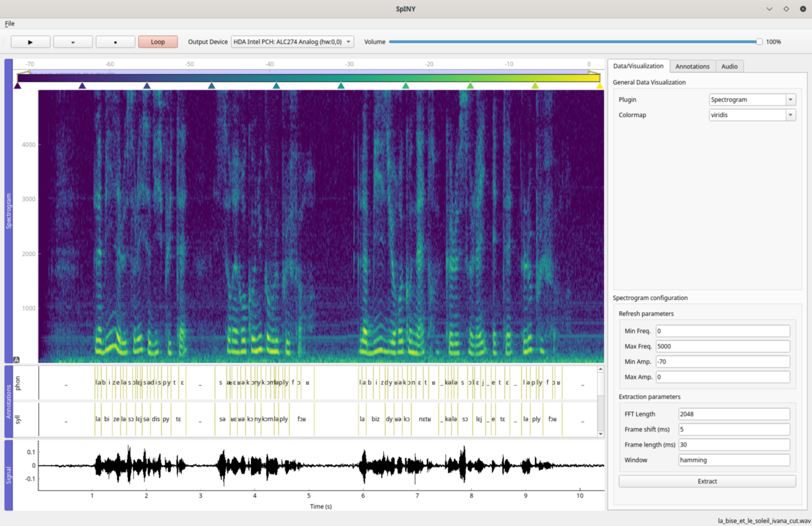

# Sp1NY

<p align="center">
**THIS TOOL IS (for now) A PROTOTYPE AND IN ITS REALLY EARLY STAGE OF DEVELOPMENT**
</p>

You should expect limited performances as well as unstable use.
We released this prototype for the Show and Tell of INTERSPEECH 2023 in order to collect the need of the community and define the directions to take to reach a useful tool.
We are making all the effort we can to improve this prototype to obtain a stable version of Sp1NY.



## Pre-requisites

It is necesary to have Qt and PortAudio installed on your system.

## Installation

To install Sp1NY, simply clone the repository and use pip:

```sh
pip install -e .
```

## Running examples

### Basic

```sh
spiny -w examples/arctic_a0002.wav
```

### With annotations


```sh
spiny -w examples/arctic_a0002.wav -a examples/arctic_a0002.lab
```

### With raw coefficients

```sh
spiny -w examples/arctic_as.wav -c examples/arctic_as.neur -d -50 -f 6.4
```

- the option `-d` indicates the dimension of the raw data; "-50" indicates a shape of (-1, 50)
- the option `-f` indicates the frameshift in milliseconds

## Keyboard shortcuts

| Action | Key | | Action | Key |
|---|---|---|---|---|
| Play / pause | `Space` | | Zoom in / out | `Ctrl+=` / `Ctrl+-` |
| Stop (back to where playback started) | `Esc` | | Show the whole signal | `Ctrl+0` |
| Go to the start / end | `Home` / `End` | | Follow the playhead | `F` |
| Back / forward 1 s | `Left` / `Right` | | Switch the theme | `Ctrl+T` |
| Slower / faster | `[` / `]` | | Open a file | `Ctrl+O` |
| Loop | `L` | | Quit | `Ctrl+Q` |
| Mute | `M` | | Delete the selected annotation | `Delete` |
| Add a tier | `Ctrl+Shift+T` | | Remove the selected tiers | `Ctrl+Shift+R` |
| Add an annotation | `Ctrl+N` | | Lock or unlock the selected tiers | `Ctrl+L` |
| Undo | `Ctrl+Z` | | Redo | `Ctrl+Shift+Z` |

*Help > Keyboard shortcuts...* shows every shortcut and lets you change them: they apply at once and are kept in the
configuration file (its comments are not).

A click on a plot moves the playhead. Changing the speed also changes the pitch, as on a tape.

## Equalizer

The *Audio* tab has a parametric equalizer, and every change is heard at once.

- **Add a band:** double-click on the curve, or use the `+` button.
- **Remove a band:** double-click or right-click its handle, or select it and use the `−` button.
- **Change a band:** drag its handle for the frequency and the gain, and turn the wheel over it for the Q. The controls
  below the curve act on the selected band, and also set its type (bell, low shelf or high shelf).

## Spectrogram and smoothing

The spectrogram computes what `To Spectrogram...` computes in Praat. The default values are Praat's (5 ms Gaussian window,
5000 Hz, 2 ms step, 20 Hz frequency step), and the panel has a control for each of these parameters and for the window
shape. Only the part around the view is computed.

*Smoothing*, in the *General Data Visualization* group, applies to the image of any plugin once it is rendered: *None*,
*Bilinear*, *Box* or *Gaussian*. Bilinear costs nothing; the two filters are applied each time the image is rendered.

## Annotation toolbar

The *Annotations* toolbar adds and removes tiers and annotations. A new annotation covers the region selected on the
waveform if there is one, otherwise it starts at the playhead, in the tier selected in the list or the tier of the
selected annotation.

Select tiers in the list and press the lock button to lock them: moving a boundary in a locked tier then moves the
boundaries at the same time (within 1 ms) in the other locked tiers, also while dragging. Locks are not saved.

Undo and redo, in the *Edit* menu, cover every operation on the tiers and the annotations, up to the last 100.

## Overlays

The *Overlay* tab lists what can be drawn over the current visualisation: tick an overlay to show it, select it to
configure it. The spectrograms support the formants, the F0 and the mask. An overlay is only drawn when the visualisation shows
something, and everything is computed in the background for the part of the signal around the view.

- **Formants:** choose the formants shown and their colours, the maximum frequency, the number of formants, the window
  length, the time step, the silence level and the maximum bandwidth.
- **F0:** choose its colour, the F0 range, the voicing threshold, the silence level and the time step.
- **Mask:** load a numpy file (`.npy`) with a matrix of opacities between 0 and 1, by default of shape (frames, frequency
  bins): where the opacity is 1 the spectrogram is visible, and where it is 0 it is transparent. The mask spans the whole
  signal and all the frequencies unless you give the time between two frames and the frequency of the last bin. It can
  also be inverted, applied partly, and show a colour instead of the background.

## Configuration

The theme, the shortcuts and the wheel are set in a YAML file: `spiny/config.yaml` in your configuration directory
(`~/.config/spiny/config.yaml` on Linux), or any file given with `--config`. Only write what you want to change:

```yaml
theme: dark
shortcuts:
  play_pause: P
  mute:          # no shortcut
themes:
  dark:
    playhead: "#00ff00"
```

What the wheel does is set in the same file. Two fingers on a trackpad are a wheel with two directions:

```yaml
wheel:                            # zoom, pan or none
  wheel_up_down: zoom
  wheel_left_right: pan
  shift_wheel_up_down: pan
  shift_wheel_left_right: pan
```

[`examples/config.yaml`](examples/config.yaml) lists every setting with its default value. A mistake in the file is
reported in the log and that setting keeps its default. `--dark` takes priority over the `theme` of the file; the theme
button only lasts for the session.

## Standalone application

Ready-to-use builds for Windows, macOS (Apple Silicon and Intel) and Linux are attached to each
[release](https://github.com/sigmedia/sp1ny/releases); no Python installation is needed.

- **Windows**: unzip `spiny-windows-x86_64.zip` and run `spiny\spiny.exe`.
- **macOS**: open `spiny-macos-*.dmg` and drag `Sp1NY.app` to your Applications. The application is not
  signed, so the first time, right-click it and choose *Open*.
- **Linux**: extract `spiny-linux-x86_64.tar.gz` and run `spiny/spiny`. PortAudio must be installed
  (`sudo apt install libportaudio2` on Debian/Ubuntu).

Started without arguments, the application asks for an audio file; the command line options above work too.
The Wavelet plugin is not included in these builds.

To build it yourself (in an environment where Sp1NY is installed):

```sh
pip install pyinstaller praat-parselmouth
cd packaging && pyinstaller --noconfirm spiny.spec
```

The application is created in `packaging/dist`.

## License

Sp1NY is released under the MIT License, see [LICENSE](LICENSE).
