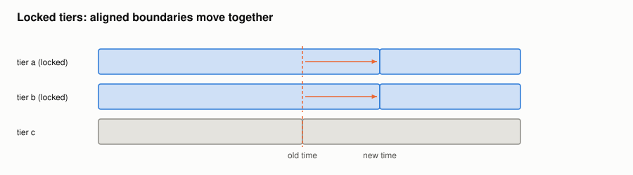

#+TITLE: Editing annotations
#+OPTIONS: toc:nil num:t

Implementation: [[file:../../spiny/annotations/visualisation.py]] and [[file:../../spiny/annotations/control.py]].

* Only the visible items

Each tier only draws the annotations which are visible and at least 50 pixels wide. The threshold is converted once into a
duration, so the test is a comparison of floats:

#+begin_example
minimum duration = 50 pixels × (x_max − x_min) / view width in pixels
#+end_example

At each change of the view, the rendered items are reconciled with this set: only the missing ones are created, and only
those which are no longer visible are removed; the selected one is kept alive.

* Creating an annotation

Two left clicks in an empty area create an annotation between the two times. The first one is kept as a time, not as a
position, as the view can change before the second one. A double click, or a click on an annotation, cancels it.
Each click also moves the cursor of the player, unless the Shift key is pressed: a playback is then left alone.

The toolbar adds an annotation on the region selected on the waveform, otherwise from the playhead for 0.2 s or until the next
annotation, and refuses if it would overlap another one.

* Zooming on an annotation

A double click on an annotation zooms on it and remembers the view it came from; the next one restores that view, not the
whole signal.

* Typing the label on the annotation

The Insert key (the =edit_label= shortcut) puts a text field over the selected annotation, as wide as its text so that the
rest of the annotation still gets the clicks. Until Enter, it has the keyboard: the one-key shortcuts of the player are
typed as text. The field and the one of the control panel follow each other, cursor included, so that an IPA symbol goes
where the cursor is. The edition is one step of the history, and ends if the annotation is unselected or leaves the view.

* Locked tiers

Moving a boundary of a locked tier moves the aligned boundaries of the other locked tiers. Two boundaries are aligned when
they are less than 1 ms apart. Each move of the mouse gives (old time, new time) pairs, which are applied to the other locked
tiers:

#+begin_example
for each annotation:  start = moved(start), end = moved(end)
                      applied if start < end        (it would otherwise have no duration)
#+end_example

Both annotations which share a boundary in another tier follow it, so they stay joined. Annotations which are not drawn are
updated in the model. The last step of a drag only comes with the signal of its end, so it is handled there too.

* Undo and redo

After each operation, the state of the annotations (times, labels, tiers and their order, hidden and locked tiers) is
recorded if it has changed: a drag or a typed label is one step, whatever the number of mouse events or keys. A typed label
also ends when another annotation is selected.

#+begin_example
undo stack: [state 0, state 1, ..., current]        redo stack: [...]
undo:  the current state moves to the redo stack, the previous one is restored
redo:  the opposite
a new operation: pushes the state and clears the redo stack
#+end_example

The stack keeps 100 operations. A tier which has not changed shares its memory with the previous state, so a step only costs
the tiers it changed. Loading a file starts a new history.
