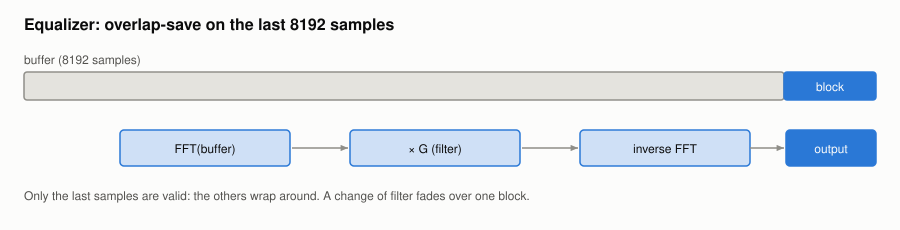

#+TITLE: Parametric equalizer
#+OPTIONS: toc:nil num:t

Implementation: [[file:../../spiny/core/wav/equalizer.py]], panel in [[file:../../spiny/core/wav/equalizer_widget.py]].

The equalizer acts on what is sent to the device, after the resampling and the speed: a band at 1 kHz stays at 1 kHz at
any speed. Any number of bands can be used; the five first ones are a low shelf, three peaks and a high shelf.

* The filters

Each band is a biquad of the Audio EQ Cookbook (R. Bristow-Johnson), computed at the playback rate from its kind,
frequency, gain and Q. With A = 10^(gain/40), ω = 2π f / rate and α = sin(ω) / (2Q), a peak is:

#+begin_example
b = [1 + αA, −2 cos ω, 1 − αA]
a = [1 + α/A, −2 cos ω, 1 − α/A]
#+end_example

The frequency is limited to 0.49 × rate: at or above the Nyquist frequency, the filter would make no sense.

* Filtering in the audio callback

A biquad is recursive, numpy has no recursive filter, and a Python loop per sample is far too slow for the audio thread.
The cascade is applied through its impulse response, which starts at once as the biquads are minimum phase, so that the
equalizer adds no delay:

#+begin_example
H(f) = product over the bands of (b0 + b1 z + b2 z²) / (1 + a1 z + a2 z²),  z = exp(−2iπ f / rate), on 32768 points
h    = inverse FFT of H, first 7168 samples, faded out over the last 8th
G    = FFT of h on 8192 points
#+end_example

Each block of at most 1024 samples is then convolved by overlap-save:

#+begin_example
buffer = the last 8192 samples, ending with the block
out    = inverse FFT of (FFT(buffer) × G), last samples only (the others wrap around)
#+end_example

The output matches the recursive filter within −60 dB, unless a very narrow band at a very low frequency rings for
longer than the 7168 samples kept.

* Changing a band during the playback

The GUI thread computes the new filter and publishes it with one assignment, so the audio thread never waits. At its
next block, the audio thread computes the output of the old and of the new filter and fades from one to the other, as
switching at once would be a click. Without any effective band, nothing is computed and the samples are untouched.

A boost can go over full scale: the output is then clipped.
