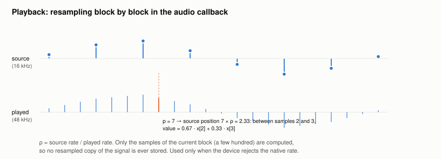

#+TITLE: Loading and playback
#+OPTIONS: toc:nil num:t

Implementation: =load_audio= and =Player= in [[file:../../spiny/core/wav/player.py]], transport in
[[file:../../spiny/core/wav/control.py]].

* Loading

=load_audio= reads the file with =soundfile= (libsndfile) directly into float32 at its native rate, and averages the
channels when there are several. The signal is kept once, at its native rate: analyses never depend on the audio device.

* Resampling and speed, in the audio callback

If the device accepts the native rate, the stream is opened at this rate. Otherwise it is opened at the default rate of
the device, and the samples are interpolated block by block in the callback: no resampled copy of the signal exists.

The callback keeps a position counted in samples of the signal, fractional as soon as the signal is resampled. With
ρ = source rate / playback rate and a speed v, each played sample moves the position by step = ρ × v. For a block of n
played samples starting at position p:

#+begin_example
positions = p + [0, 1, ..., n − 1] × step
i0        = floor(positions)            (clipped to the last sample)
i1        = min(i0 + 1, last sample)
frac      = positions − i0
out       = (1 − frac) × x[i0] + frac × x[i1]
p         = p + n × step
#+end_example

When step = 1 and p is a whole number, the block is simply copied. The speed can change between two blocks. It is
tape-style: the pitch follows it, as keeping the pitch would need a time-stretching algorithm.

The linear interpolation is fine to listen to and is never used for analysis.

* What a block goes through

#+begin_example
resampled samples → zeros after the end of the part → equalizer → volume (0 if muted) → clip to ±1 if equalized
#+end_example

See [[file:equalizer.org]] for the equalizer.

* Transport: the cursor and the position

Two values describe where the player is:

- the *cursor*, in seconds, is where a playback starts: a click on a plot or "return to start" moves it;
- the *position*, in samples of the signal, belongs to the audio callback during a playback.

The time shown and the playheads are the position during a playback and the cursor otherwise.

#+begin_example
play          start at the cursor (at 0 if the cursor is at the very end)
pause/resume  the stream stays open and plays zeros, the position does not move
stop          the position is dropped: the display is back at the cursor
seek(t)       cursor = t; during a playback, position = t × source rate
loop          at the end of the played part, position = the sample where this playback started
#+end_example

Skipping seeks 1 s away from the current position. "Follow the playhead" turns the page: when the playhead leaves the view, the view
restarts at the playhead with the same width.

* Real-time constraints

The callback runs on the real-time thread of PortAudio, and it is Python code:

- it never touches Qt: the toolbar and the playheads read the player every 30 ms from the GUI thread;
- a new playback first waits for the end of the stream which was just stopped, otherwise its last callback would
  continue with the new playback, or its end would stop it;
- the interpreter switch interval is lowered to 1 ms (=sys.setswitchinterval=): with the default 5 ms, waiting for the
  interpreter can take as long as a whole block.
