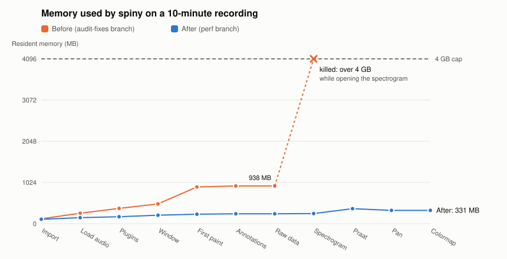
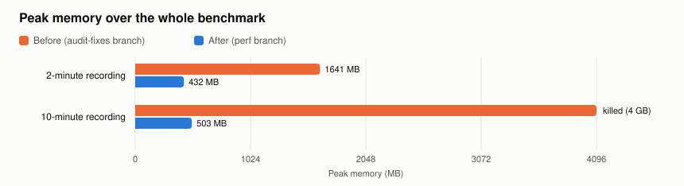
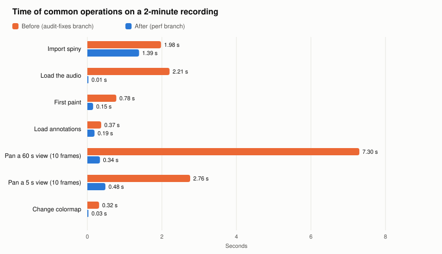

#+TITLE: Sp1NY performance improvements
#+SUBTITLE: Loading time and memory usage
#+DATE: 2026-10-28
#+OPTIONS: toc:2 num:t

* Summary

Sp1NY could not open a 10-minute recording: opening the spectrogram needed more than 4 GB of
memory, and the application had already reached about 1 GB before any analysis ran. The changes
described here (branch =perf=) make it:

- *use much less memory*: a 10-minute recording now peaks at about 500 MB for the whole session (Praat
  spectrogram included), where the old code was killed above 4 GB; a 2-minute recording peaks at 432 MB
  instead of 1641 MB;
- *start and load faster*: loading the audio is 37 to 200 times faster (librosa is gone), the first
  paint 5 to 19 times faster; only the visible part of the spectrogram is computed (60 ms for 30 s and its margins);
- *stay responsive*: panning a 5 s view costs about 50 ms per frame instead of 276 ms, and a colormap
  change about 30 ms instead of 320 ms (2-minute file).

The wavelet plugin was out of scope and has not been changed. The algorithms behind these numbers
are explained in the documents listed in [[*Algorithms][Algorithms]].

#+CAPTION: Resident memory after each step of the benchmark, on a 10-minute recording. The old code was killed by the 4 GB cap while opening the spectrogram.

* Method

** What is measured

The benchmark ([[file:scripts/bench.py]]) drives the real GUI (offscreen Qt) through the steps a user
goes through, and records after each step its duration, the resident memory (RSS) and the peak
resident memory of the process:

1. import spiny, load the audio, discover the plugins, build the window and paint it;
2. load an annotation file;
3. select each data plugin (Raw DATA, Spectrogram, Spectrogram (Praat));
4. pan 10 frames in a full view, a 60 s view and a 5 s view (each frame is a full render of the
   window);
5. change the colormap.

The wavelet plugin is excluded (=BENCH_NO_WAVELET=1=).

** Data

Two synthetic recordings are generated by [[file:scripts/gen_data.py]], at 16 kHz with dense
annotations and raw coefficients:

| Recording | Duration | Samples   | Annotations (3 tiers) | Raw coefficients    |
|-----------+----------+-----------+-----------------------+---------------------|
| short     | 2 min    | 1 920 000 | 2 660                 | 24 000 x 50 float32  |
| long      | 10 min   | 9 600 000 | 13 403                | 120 000 x 50 float32 |

** Environment

- Intel Core i5-1235U (12 threads), 7 GB of RAM, Linux 7.2;
- Python 3.13.5, PySide6 6.12.0, pyqtgraph 0.14.0, numpy 2.5.4, parselmouth 0.4.7;
- every run is limited to *4 GB of RAM without swap* (=systemd-run --user --scope -p MemoryMax=4G
  -p MemorySwapMax=0=): a process above the limit is killed.

"Before" is the =audit-fixes= branch with the Python 3.13 requirement (commit =a97d353=); "after"
is the =perf= branch. Both were measured in the same session.

* Results

#+CAPTION: Peak memory over the whole benchmark.

#+CAPTION: Duration of common operations on the 2-minute recording (the 10-minute run of the old code did not finish).

The stars mark a value which is not comparable: the view is longer than the maximum visible duration (30 s),
so the new code only shows a message, while the old code computed the whole spectrogram. See
[[file:spectrogram.org]] for the time of a view which is computed. Also, the pans do not include the background
analysis, which starts after the movement.

** 2-minute recording

| Stage                      | Before (s) | After (s) | Before RSS (MB) | After RSS (MB) | Before peak (MB) | After peak (MB) |
|----------------------------+------------+-----------+-----------------+----------------+------------------+-----------------|
| Import spiny               |       1.98 |      1.39 |             121 |            111 |              120 |             111 |
| Load the audio             |       2.21 |      0.01 |             233 |            122 |              247 |             122 |
| Discover plugins           |       0.12 |      0.08 |             350 |            145 |              349 |             145 |
| Build the window           |       0.30 |      0.32 |             384 |            164 |              383 |             164 |
| First paint                |       0.78 |      0.15 |             486 |            188 |              485 |             194 |
| Load annotations           |       0.37 |      0.19 |             494 |            196 |              493 |             195 |
| Select Raw DATA            |       0.10 |      0.01 |             494 |            196 |              493 |             195 |
| Select Spectrogram         |       5.53 |     0.12* |             817 |            207 |             1324 |             207 |
| Select Spectrogram (Praat) |       0.64 |      1.04 |             891 |            294 |             1324 |             432 |
| Pan, full view (10 frames) |       3.72 |      0.38 |             950 |            294 |             1641 |             432 |
| Pan, 60 s view (10 frames) |       7.30 |      0.34 |             950 |            294 |             1641 |             432 |
| Pan, 5 s view (10 frames)  |       2.76 |      0.48 |             950 |            294 |             1641 |             432 |
| Change colormap            |       0.32 |      0.03 |             950 |            294 |             1641 |             432 |

** 10-minute recording

| Stage                      | Before (s) | After (s) | Before RSS (MB) | After RSS (MB) | Before peak (MB) | After peak (MB) |
|----------------------------+------------+-----------+-----------------+----------------+------------------+-----------------|
| Import spiny               |       1.94 |      1.72 |             121 |            109 |              121 |             108 |
| Load the audio             |       2.20 |      0.06 |             261 |            149 |              334 |             148 |
| Discover plugins           |       0.12 |      0.11 |             380 |            172 |              379 |             170 |
| Build the window           |       0.38 |      0.43 |             491 |            210 |              529 |             209 |
| First paint                |       3.31 |      0.17 |             913 |            236 |              912 |             240 |
| Load annotations           |       1.13 |      0.24 |             938 |            246 |              937 |             245 |
| Select Raw DATA            |       0.30 |      0.02 |             938 |            246 |              937 |             245 |
| Select Spectrogram         |     killed |     0.11* |               — |            252 |                — |             258 |
| Select Spectrogram (Praat) |     killed |      4.30 |               — |            373 |                — |             503 |
| Pan, full view (10 frames) |     killed |      0.36 |               — |            331 |                — |             503 |
| Pan, 60 s view (10 frames) |     killed |      0.52 |               — |            331 |                — |             503 |
| Pan, 5 s view (10 frames)  |     killed |      0.47 |               — |            331 |                — |             503 |
| Change colormap            |     killed |      0.03 |               — |            331 |                — |             503 |

* Algorithms

Each improvement is explained in its own document, with a diagram, the reasoning behind it and its
measured effect.

| Document                    | Algorithm                                                                                   | Commits          |
|-----------------------------+---------------------------------------------------------------------------------------------+------------------|
| [[file:waveform.org]]        | min/max pyramid of the signal, one vertical segment per pixel column                         | 2039dda          |
| [[file:spectrogram.org]]     | only the visible frames, by blocks, on 8 bits; maximum visible duration; live update         | 5481f81, f3f9bc0 |
| [[file:image-rendering.org]] | visible-slice rendering of the data images, update hysteresis, release of hidden plugins     | d367a61, 197bc4c |
| [[file:praat.org]]           | Praat analysis by chunks with margins, two passes, 8-bit quantization                       | 570e7d5, 3aab772 |
| [[file:playback.org]]        | soundfile loading, linear resampling block by block in the audio callback                   | 386e8f2          |
| [[file:overlays.org]]        | formants and F0 on batches of frames, kept by chunks, computed around the view              |                  |
| [[file:other.org]]           | memory-mapped coefficients, colormaps without matplotlib, import blocking, slotted annotations | 658e847, ae18410, a9bd03a, 489ec93 |

The common idea is that *only what can be seen needs to be computed or kept at full precision*:

- a screen shows about 1 500 columns, so the waveform and the images are reduced to the visible range
  at screen resolution (pyramid, visible slice) instead of being drawn sample by sample or frame by
  frame;
- a colormap shows a few hundred colours, so spectrograms are stored as 8-bit codes over the
  displayed decibel range instead of float64;
- large intermediate results (the complex STFT, a resampled copy of the signal, a Praat analysis of
  the whole recording) are produced block by block and never held entirely;
- libraries are imported when they are used (parselmouth) or not at all (librosa, matplotlib).

* Trade-offs and limitations

- The *spectrogram is stored on 8 bits*: 256 levels over 80 dB (0.31 dB per level).
- By default, *no spectrogram is shown for a view longer than 30 s*: the slider goes up to 600 s, a longer
  view always shows the message.
- The *Praat spectrogram* still analyses the whole recording, and is slightly slower on short recordings
  (1.04 s instead of 0.64 s for 2 minutes) because it makes two passes over the signal; it is now displayed over a 70 dB range
  below its maximum instead of the full dB range.
- *Playback resampling*, only used when the device cannot play the native rate, is a linear
  interpolation: fine to listen to, never used for analysis.
- The *cividis* colormap bundled with pyqtgraph is the original table; matplotlib uses a slightly
  revised one (the darkest blues differ by up to about 20/255).
- The *wavelet plugin* was not optimized. On a 2-minute recording, its pitch tracker (in
  wavelet_prosody_toolkit) takes about 37 s and 4 GB.
- Annotations only appear in a tier after the first change of the visible range (this was already
  the case before these changes).

* Standalone application

The same branch adds standalone builds (PyInstaller, see =packaging/spiny.spec=), produced for
Linux, Windows and macOS (arm64 and x86_64) by the =Standalone binaries= workflow and attached to the
releases. The application is a folder rather than a single file, which would unpack itself at
every launch and start several seconds slower. On Linux it measures 282 MB (105 MB compressed) and
shows its window in about 0.9 s.

* Reproducing the measurements

From the root of the repository, in an environment where spiny is installed (with psutil):

#+begin_src sh
python docs/improvement/scripts/gen_data.py /tmp/spiny-data short 120
python docs/improvement/scripts/gen_data.py /tmp/spiny-data long 600
BENCH_NO_WAVELET=1 systemd-run --user --scope -p MemoryMax=4G -p MemorySwapMax=0 \
    python docs/improvement/scripts/bench.py /tmp/spiny-data long
#+end_src

Each stage prints a =STAGE= line, so a run killed by the memory limit still shows how far it got.
The result figures are generated from =assets/benchmark.json= by =assets/make_figures.py=, the
diagrams of the algorithm documents by =assets/make_diagrams.py=.
