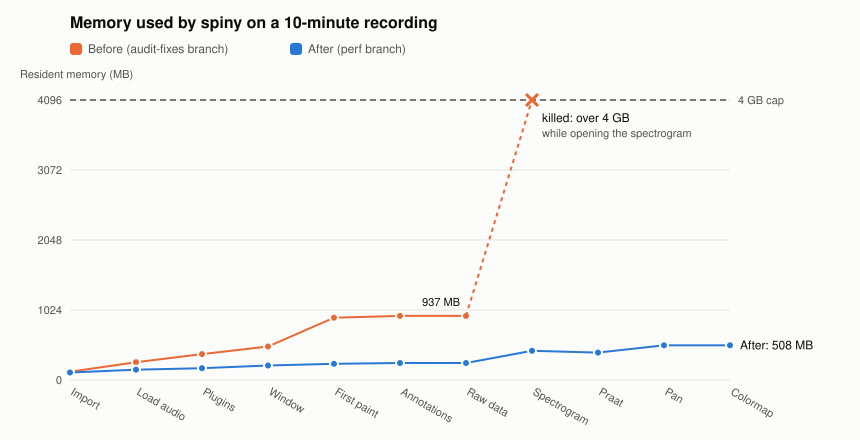
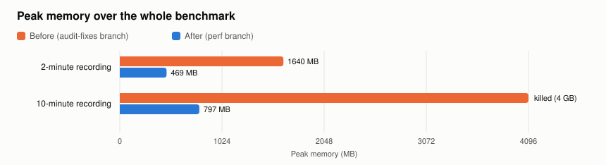
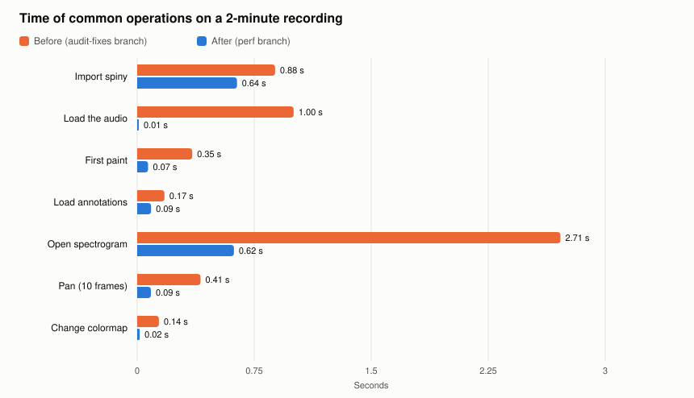

#+TITLE: Sp1NY performance improvements
#+SUBTITLE: Loading time and memory usage
#+DATE: 2026-10-28
#+OPTIONS: toc:2 num:t

* Summary

Sp1NY could not open a 10-minute recording: opening the spectrogram needed more than 4 GB of
memory, and the application had already reached about 1 GB before any analysis ran. The changes
described here (branch =perf=) make it:

- *use 3 to 5 times less memory*: a 10-minute recording now peaks at 797 MB for the whole
  session, where the old code was killed above 4 GB; a 2-minute recording peaks at 469 MB instead
  of 1640 MB;
- *start and load faster*: loading the audio is 20 to 100 times faster (librosa is gone), the
  first paint 5 to 17 times faster, and opening the spectrogram 4 times faster on a 2-minute file;
- *stay responsive*: panning costs about 10 ms per frame instead of 40 ms, and a colormap change
  about 20 ms instead of 140 ms (2-minute file).

The wavelet plugin was out of scope and has not been changed. The algorithms behind these numbers
are explained in the documents listed in [[*Algorithms][Algorithms]].

#+CAPTION: Resident memory after each step of the benchmark, on a 10-minute recording. The old code was killed by the 4 GB cap while opening the spectrogram.

* Method

** What is measured

The benchmark ([[file:scripts/bench.py]]) drives the real GUI (offscreen Qt) through the steps a user
goes through, and records after each step its duration, the resident memory (RSS) and the peak
resident memory of the process:

1. import spiny, load the audio, discover the plugins, build the window and paint it;
2. load an annotation file;
3. select each data plugin (Raw DATA, Spectrogram, Spectrogram (Praat));
4. pan 10 frames in a full view, a 60 s view and a 5 s view (each frame is a full render of the
   window);
5. change the colormap.

The wavelet plugin is excluded (=BENCH_NO_WAVELET=1=).

** Data

Two synthetic recordings are generated by [[file:scripts/gen_data.py]], at 16 kHz with dense
annotations and raw coefficients:

| Recording | Duration | Samples   | Annotations (3 tiers) | Raw coefficients    |
|-----------+----------+-----------+-----------------------+---------------------|
| short     | 2 min    | 1 920 000 | 2 660                 | 24 000 x 50 float32  |
| long      | 10 min   | 9 600 000 | 13 403                | 120 000 x 50 float32 |

** Environment

- Intel Core i5-1235U (12 threads), 7 GB of RAM, Linux 7.2;
- Python 3.13.5, PySide6 6.12.0, pyqtgraph 0.14.0, numpy 2.5.4, parselmouth 0.4.7;
- every run is limited to *4 GB of RAM without swap* (=systemd-run --user --scope -p MemoryMax=4G
  -p MemorySwapMax=0=): a process above the limit is killed.

"Before" is the =audit-fixes= branch with the Python 3.13 requirement (commit =a97d353=); "after"
is the =perf= branch.

* Results

#+CAPTION: Peak memory over the whole benchmark.

#+CAPTION: Duration of common operations on the 2-minute recording (the 10-minute run of the old code did not finish).

** 2-minute recording

| Stage                      | Before (s) | After (s) | Before RSS (MB) | After RSS (MB) | Before peak (MB) | After peak (MB) |
|----------------------------+------------+-----------+-----------------+----------------+------------------+-----------------|
| Import spiny               |       0.88 |      0.64 |             121 |            111 |              121 |             110 |
| Load the audio             |       1.00 |      0.01 |             232 |            122 |              246 |             122 |
| Discover plugins           |       0.05 |      0.04 |             350 |            144 |              349 |             143 |
| Build the window           |       0.16 |      0.14 |             384 |            164 |              383 |             164 |
| First paint                |       0.35 |      0.07 |             485 |            189 |              484 |             195 |
| Load annotations           |       0.17 |      0.09 |             494 |            196 |              493 |             195 |
| Select Raw DATA            |       0.04 |      0.01 |             494 |            196 |              493 |             195 |
| Select Spectrogram         |       2.71 |      0.62 |             817 |            274 |             1323 |             329 |
| Select Spectrogram (Praat) |       0.39 |      0.56 |             891 |            330 |             1323 |             469 |
| Pan, full view (10 frames) |       0.43 |      0.12 |             949 |            357 |             1640 |             469 |
| Pan, 60 s view (10 frames) |       0.40 |      0.09 |             949 |            357 |             1640 |             469 |
| Pan, 5 s view (10 frames)  |       0.41 |      0.09 |             949 |            357 |             1640 |             469 |
| Change colormap            |       0.14 |      0.02 |             949 |            357 |             1640 |             469 |

** 10-minute recording

| Stage                      | Before (s) | After (s) | Before RSS (MB) | After RSS (MB) | Before peak (MB) | After peak (MB) |
|----------------------------+------------+-----------+-----------------+----------------+------------------+-----------------|
| Import spiny               |       1.03 |      0.70 |             121 |            109 |              120 |             109 |
| Load the audio             |       1.20 |      0.06 |             261 |            150 |              334 |             149 |
| Discover plugins           |       0.07 |      0.04 |             379 |            173 |              378 |             172 |
| Build the window           |       0.31 |      0.20 |             490 |            212 |              528 |             211 |
| First paint                |       1.67 |      0.10 |             912 |            237 |              911 |             242 |
| Load annotations           |       0.56 |      0.13 |             937 |            248 |              936 |             247 |
| Select Raw DATA            |       0.15 |      0.01 |             937 |            248 |              936 |             247 |
| Select Spectrogram         |     killed |      3.02 |               — |            427 |                — |             714 |
| Select Spectrogram (Praat) |     killed |      2.35 |               — |            401 |                — |             714 |
| Pan, full view (10 frames) |     killed |      0.11 |               — |            508 |                — |             797 |
| Pan, 60 s view (10 frames) |     killed |      0.11 |               — |            508 |                — |             797 |
| Pan, 5 s view (10 frames)  |     killed |      0.10 |               — |            508 |                — |             797 |
| Change colormap            |     killed |      0.02 |               — |            508 |                — |             797 |

* Algorithms

Each improvement is explained in its own document, with a diagram, the reasoning behind it and its
measured effect.

| Document                    | Algorithm                                                                                   | Commits          |
|-----------------------------+---------------------------------------------------------------------------------------------+------------------|
| [[file:waveform.org]]        | min/max pyramid of the signal, one vertical segment per pixel column                         | 2039dda          |
| [[file:spectrogram.org]]     | block-wise, multi-threaded STFT in one pass (float16 buffer), 8-bit quantization            | 5481f81, f3f9bc0 |
| [[file:image-rendering.org]] | visible-slice rendering of the data images, update hysteresis, release of hidden plugins     | d367a61, 197bc4c |
| [[file:praat.org]]           | Praat analysis by chunks with margins, two passes, 8-bit quantization                       | 570e7d5, 3aab772 |
| [[file:playback.org]]        | soundfile loading, linear resampling block by block in the audio callback                   | 386e8f2          |
| [[file:other.org]]           | memory-mapped coefficients, colormaps without matplotlib, import blocking, slotted annotations | 658e847, ae18410, a9bd03a, 489ec93 |

The common idea is that *only what can be seen needs to be computed or kept at full precision*:

- a screen shows about 1 500 columns, so the waveform and the images are reduced to the visible range
  at screen resolution (pyramid, visible slice) instead of being drawn sample by sample or frame by
  frame;
- a colormap shows a few hundred colours, so spectrograms are stored as 8-bit codes over the
  displayed decibel range instead of float64;
- large intermediate results (the complex STFT, a resampled copy of the signal, a Praat analysis of
  the whole recording) are produced block by block and never held entirely;
- libraries are imported when they are used (parselmouth) or not at all (librosa, matplotlib).

* Trade-offs and limitations

- The *spectrogram is stored on 8 bits*: 256 levels over the chosen amplitude range (0.27 dB per
  level for 70 dB). Changing the amplitude range requires a new extraction, as before.
- During its extraction, the spectrogram needs about 3 bytes per kept time-frequency cell (a float16
  buffer while the global maximum is searched), 1 byte afterwards: about 450 MB, then 150 MB, for
  10 minutes at the default settings.
- The *Praat spectrogram* is slightly slower on short recordings (0.56 s instead of 0.39 s for
  2 minutes) because it makes two passes over the signal; it is now displayed over a 70 dB range
  below its maximum instead of the full dB range.
- *Playback resampling*, only used when the device cannot play the native rate, is a linear
  interpolation: fine to listen to, never used for analysis.
- The *cividis* colormap bundled with pyqtgraph is the original table; matplotlib uses a slightly
  revised one (the darkest blues differ by up to about 20/255).
- The *wavelet plugin* was not optimized. On a 2-minute recording, its pitch tracker (in
  wavelet_prosody_toolkit) takes about 37 s and 4 GB.
- Annotations only appear in a tier after the first change of the visible range (this was already
  the case before these changes).

* Standalone application

The same branch adds standalone builds (PyInstaller, see =packaging/spiny.spec=), produced for
Linux, Windows and macOS (arm64 and x86_64) by the =Standalone binaries= workflow and attached to the
releases. The application is a folder rather than a single file, which would unpack itself at
every launch and start several seconds slower. On Linux it measures 282 MB (105 MB compressed) and
shows its window in about 0.9 s.

* Reproducing the measurements

From the root of the repository, in an environment where spiny is installed (with psutil):

#+begin_src sh
python docs/improvement/scripts/gen_data.py /tmp/spiny-data short 120
python docs/improvement/scripts/gen_data.py /tmp/spiny-data long 600
BENCH_NO_WAVELET=1 systemd-run --user --scope -p MemoryMax=4G -p MemorySwapMax=0 \
    python docs/improvement/scripts/bench.py /tmp/spiny-data long
#+end_src

Each stage prints a =STAGE= line, so a run killed by the memory limit still shows how far it got.
The result figures are generated from =assets/benchmark.json= by =assets/make_figures.py=, the
diagrams of the algorithm documents by =assets/make_diagrams.py=.
