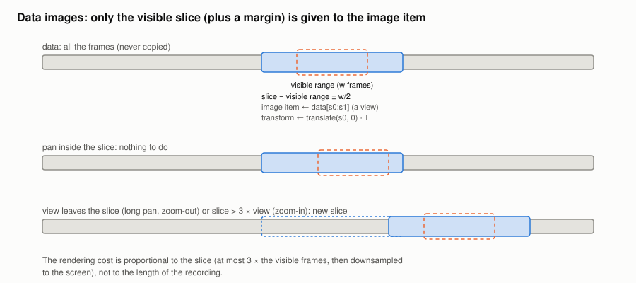

#+TITLE: Data images: visible-slice rendering
#+OPTIONS: toc:nil num:t

Implementation: =DataWidget= in [[file:../../spiny/gui/widgets.py]] and =DataController.release= in
[[file:../../spiny/core/plugin_management.py]] (commits =d367a61= and =197bc4c=).

* The problem

The data plots (spectrograms, raw coefficients) are pyqtgraph =ImageItem= objects. At every render
(a pan, a zoom, a colormap change), an =ImageItem= converts its *whole* image into a =QImage=. With
=autoDownsample=, it first reduces the image by a factor chosen from the density of the *visible*
part:

#+begin_example
downsampling factor ≈ max(1, visible frames / screen pixels)
rendered columns    ≈ all frames / factor
#+end_example

When the whole recording is visible, this works: 120 000 frames are reduced to about 1 500 columns.
But when the view is zoomed in on a few seconds, the factor drops to 1 and the whole image is rendered
at full resolution: a 120 001 × 640 image for a 10-minute spectrogram, 300 MB and about 2 s for each
render, although only 1 500 columns are visible.

* The algorithm

** Give the image item only what is visible

=DataWidget= keeps the full data (frames × dimensions) and its transform T, which places frame and
dimension indices in plot coordinates (seconds × Hz, for example). The image item only receives a
*slice* of frames:

1. The visible x range is mapped back to frames with the inverse transform:
   =[f0, f1) = T⁻¹([x_min, x_max])=, of width w = f1 − f0.
2. The slice covers the visible frames plus a margin of w / 2 on each side (clipped to the data):
   =[s0, s1) = [f0 − w/2, f1 + w/2)=.
3. The image item gets =data[s0:s1]=: a numpy view, so nothing is copied, even for a memory-mapped
   file.
4. The slice starts at frame s0 instead of 0, so the item transform is the data transform preceded by a
   translation of s0 frames: =translate(s0, 0) · T= (Qt composes transforms from left to right).

The slice is then rendered with =autoDownsample=, as before, but its size is at most about 3 × w
frames: the render produces about one column per screen pixel whatever the zoom level.

** When to update the slice (hysteresis)

The slice is recomputed when the visible range changes (=sigXRangeChanged=) or the widget is
resized, but only if it is needed:

#+begin_example
keep the current slice [s0, s1)  if  s0 ≤ f0  and  f1 ≤ s1  and  s1 − s0 ≤ 3 × w
otherwise                         new slice = [f0 − w/2, f1 + w/2)
#+end_example

- a small pan stays inside the margin: nothing to do, the image item keeps its rendered image;
- a long pan or a zoom-out makes the view leave the slice: it is recomputed around the new view;
- a zoom-in makes the slice more than 3 times wider than the view: it is recomputed too, so that a
  zoomed-in view never keeps rendering a slice much larger than necessary.

** Levels

When the display levels are not given (raw coefficients), they are estimated *once* from at most one
million values of the whole data (a strided subsample), so that they do not change while panning.
The 8-bit spectrograms use the fixed levels (0, 255): no scan of the data at all.

** Release of hidden plugins

Selecting a plugin used to keep the data of the previously selected plugins in memory, although
they are extracted again when selected again. =DataController.release()= now drops the image and the
extractor result of the plugin that is not displayed anymore.

* Results

| Measure (10-minute recording)            | Before                  | After       |
|------------------------------------------+-------------------------+-------------|
| Rendered image when zoomed in            | 120 001 × 640 (≈ 2 s)   | ≈ 1 500 wide |
| Colormap change                          | about 2 s when zoomed in| 0.02 s      |
| Peak memory over the session             | killed (> 4 GB)         | 797 MB      |

(The "before" column of the first two lines was measured on the branch right before this change,
since the original code could not open a 10-minute spectrogram at all.)
