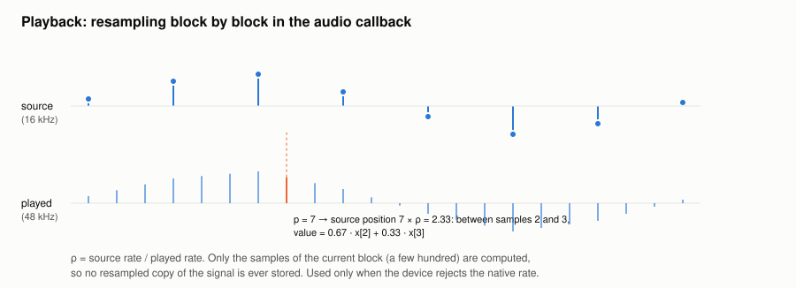

#+TITLE: Audio loading and playback resampling
#+OPTIONS: toc:nil num:t

Implementation: =load_audio= and =Player= in [[file:../../spiny/core/wav/player.py]] (commit
=386e8f2=).

* The problem

- Audio files were loaded with =librosa.load=. librosa was only used for this and for the
  spectrogram, but importing it costs about 1 s and 100 MB (it pulls numba and scipy).
- When the output device could not play the native rate of the file (a 16 kHz file on a 48 kHz
  device, for instance), the player kept a resampled copy of the whole signal: 3 times its size for
  16 to 48 kHz.

* Loading

=load_audio= reads the file with =soundfile= (libsndfile) directly into float32 at its native rate:

#+begin_src python
signal, sampling_rate = sf.read(filename, dtype="float32", always_2d=True)
if signal.shape[1] > 1:
    signal = signal.mean(axis=1, dtype=np.float32, keepdims=True)   # mono, as librosa.load did
#+end_src

No float64 intermediate copy is made, and libsndfile reads wav, flac, ogg, aiff and mp3.

* Playback resampling in the audio callback

When the device accepts the native rate, the samples are copied as they are. Otherwise the stream is
opened at the device default rate and the samples are interpolated *block by block*, inside the
PortAudio callback, only for the block being played.

With ρ = source rate / playback rate, the played sample p corresponds to the source position p × ρ.
For a block of n played samples starting at p:

#+begin_example
positions = (p + [0, 1, ..., n − 1]) × ρ
i0        = floor(positions)            (clipped to the last sample)
i1        = min(i0 + 1, last sample)
frac      = positions − i0
out       = (1 − frac) × x[i0] + frac × x[i1]
#+end_example

The callback keeps a position counted in played samples. The playback boundaries are converted once
when playing starts: played samples = ⌊(N − 1) / ρ⌋ + 1, start = start time × playback rate, and
the position shown in the GUI is played position / playback rate.

The work per callback is proportional to the block size (a few hundred samples), which is negligible
for the real-time thread, and nothing proportional to the signal is ever allocated.

** Limits

A linear interpolation is fine to listen to when the device rate is higher than the source rate (the
usual case). It is never used for analysis: every plugin works on the signal at its native rate.

* Results

| Measure                        | Before (librosa) | After (soundfile) |
|--------------------------------+------------------+-------------------|
| Load the audio, 2 min          | 1.00 s           | 0.01 s            |
| Load the audio, 10 min         | 1.20 s           | 0.06 s            |
| Resampled copy for playback    | 3 × the signal   | none              |
