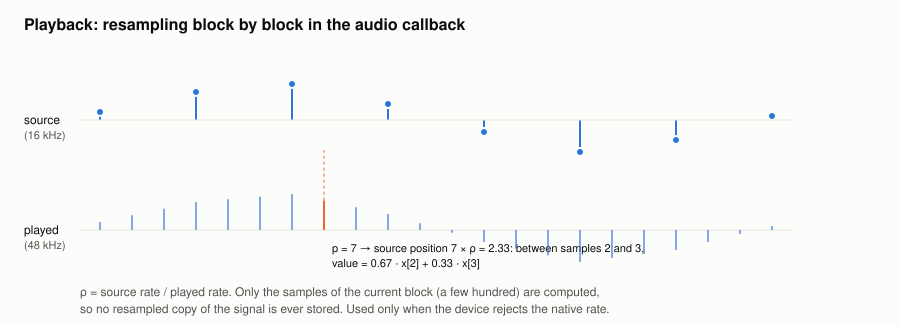

#+TITLE: Audio loading and playback resampling
#+OPTIONS: toc:nil num:t

Implementation: =load_audio= and =Player= in [[file:../../spiny/core/wav/player.py]] (commit
=386e8f2=).

* The problem

- Audio files were loaded with =librosa.load=. librosa was only used for this and for the
  spectrogram, but importing it costs about 1 s and 100 MB (it pulls numba and scipy).
- When the output device could not play the native rate of the file (a 16 kHz file on a 48 kHz
  device, for instance), the player kept a resampled copy of the whole signal: 3 times its size for
  16 to 48 kHz.

* Loading

=load_audio= reads the file with =soundfile= (libsndfile) directly into float32 at its native rate:

#+begin_src python
signal, sampling_rate = sf.read(filename, dtype="float32", always_2d=True)
if signal.shape[1] > 1:
    signal = signal.mean(axis=1, dtype=np.float32, keepdims=True)   # mono, as librosa.load did
#+end_src

No float64 intermediate copy is made, and libsndfile reads wav, flac, ogg, aiff and mp3.

* Playback resampling in the audio callback

When the device accepts the native rate, the samples are copied as they are. Otherwise the stream is
opened at the device default rate and the samples are interpolated *block by block*, inside the
PortAudio callback, only for the block being played.

The callback keeps a position counted in samples of the signal, fractional as soon as the signal is resampled.
With ρ = source rate / playback rate and a speed v, each played sample moves the position by step = ρ × v. For a
block of n played samples starting at position p:

#+begin_example
positions = p + [0, 1, ..., n − 1] × step
i0        = floor(positions)            (clipped to the last sample)
i1        = min(i0 + 1, last sample)
frac      = positions − i0
out       = (1 − frac) × x[i0] + frac × x[i1]
p         = p + n × step
#+end_example

The block is simply copied when step = 1 and p is a whole number. Counting in samples of the signal means the
boundaries do not depend on the device, the position shown in the GUI is p / source rate, and the speed can change
between two blocks. A speed v is a tape-style change: the pitch follows it. Keeping the pitch would need a time
stretching algorithm.

The work per callback is proportional to the block size (a few hundred samples), which is negligible
for the real-time thread, and nothing proportional to the signal is ever allocated.

** Limits

A linear interpolation is fine to listen to when the device rate is higher than the source rate (the
usual case). It is never used for analysis: every plugin works on the signal at its native rate.

* Transport

The toolbar follows the transport of a DAW; it only needs two values in the player.

- The *cursor* (in seconds) is where a playback starts. A click on any plot, or "return to start", moves it.
- The *position* (in samples of the signal) belongs to the audio callback during a playback.

The time shown, and the playhead drawn over every plot, are the position during a playback and the cursor
otherwise:

#+begin_example
play          start at the cursor (at 0 if the cursor is at the very end)
pause/resume  the stream stays open and plays zeros, the position does not move
stop          the position is dropped: the display is back at the cursor
seek(t)       cursor = t; during a playback, position = t × source rate
loop          at the end of the played part, position = the sample where this playback started
#+end_example

The audio thread never touches Qt: the toolbar and the playheads read the player every 30 ms from the GUI
thread. A playhead only moves if its plot is visible and the position moved by at least half a pixel: on a
full view of 10 minutes, the position takes about 13 polls to cross one pixel, and each move repaints the plot
under the line. The waveform keeps its last path, which only depends on the view, so these repaints do not
rebuild it. Together, on a 10-minute recording, this brings the moving playhead from 29 % to 9 % of one core on the
full view (measured offscreen); on a 20 s view the line moves at nearly every poll, so the gain is small.

A new playback first waits for the end of the stream which was just stopped: its last callback would otherwise
continue with the new playback, or its end would stop it.

* Parametric equalizer

Implementation: [[file:../../spiny/core/wav/equalizer.py]]. Any number of bands (five to start with: a low shelf, three peaks, a high shelf), each
with a frequency, a gain and a Q. Every change is heard at once.

** The filters

Each band is a biquad of the Audio EQ Cookbook (R. Bristow-Johnson), computed at the playback rate. The filter acts on
what is sent to the device: after the resampling and the speed change, so a band at 1 kHz stays at 1 kHz at any speed.

** Filtering in the audio callback

A biquad is recursive: each output sample needs the previous one. numpy has no recursive filter, a Python loop per
sample is far too slow for the real-time thread, and scipy is a heavy dependency for one function. The cascade of the
biquads is applied instead through its impulse response:

#+begin_example
H(f) = product over the bands of (b0 + b1 z + b2 z²) / (1 + a1 z + a2 z²),  z = exp(−2iπ f / rate)
h    = inverse FFT of H, first 7168 samples, faded out over the last 8th
G    = FFT of h on 8192 points
#+end_example

Each block of at most 1024 samples is then convolved by overlap-save, on the last 8192 samples played:

#+begin_example
buffer = last 8192 samples, ending with the block
out    = inverse FFT of (FFT(buffer) × G), last samples only (the others wrap around)
#+end_example

The biquads are minimum phase, so the impulse response starts at once: the equalizer adds no delay. The output matches
the recursive filter within −60 dB, unless a very narrow band at a very low frequency rings for longer than the 7168
samples kept.

** Changing a band during the playback

The GUI thread computes the new filter (about 1 ms) and publishes it with one assignment: the audio thread never waits.
At its next block, the audio thread computes the output with the old and the new filter and fades from one to the
other, as switching at once would be a click. When no band has a gain, nothing is computed and the samples are
untouched.

The cost in the callback is two FFTs per block of up to 1024 samples: about 0.1 ms, which is 1.7 % of the time
available for a block of 256 samples at 48 kHz. A boost can go over full scale: the output is then clipped.

* Results

| Measure                        | Before (librosa) | After (soundfile) |
|--------------------------------+------------------+-------------------|
| Load the audio, 2 min          | 2.21 s           | 0.01 s            |
| Load the audio, 10 min         | 2.20 s           | 0.06 s            |
| Resampled copy for playback    | 3 × the signal   | none              |
