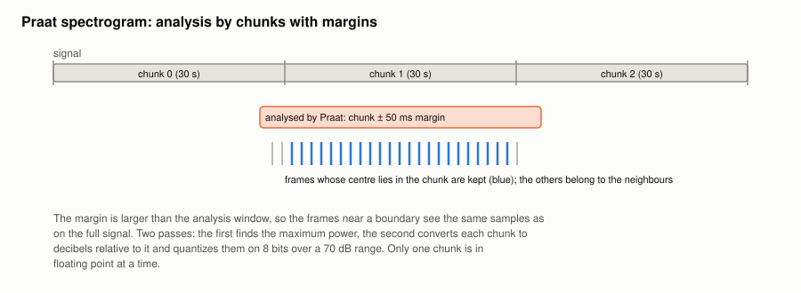

#+TITLE: Praat spectrogram: chunked analysis
#+OPTIONS: toc:nil num:t

Implementation: [[file:../../spiny/plugins/spectrum_praat/extractor.py]] (commits =570e7d5= and
=3aab772=).

* The problem

The Praat spectrogram was computed on the whole signal at once with parselmouth, then converted to
decibels in another float64 array. With Praat's default settings (2 ms time step, 5 ms Gaussian
window, frequencies up to 5 kHz), a 10-minute recording has about 300 000 frames: hundreds of MB of
float64 for something displayed with a colormap. parselmouth was also imported at startup, even when
the plugin was never used.

* The algorithm

** Lazy import

The plugin only checks at startup that parselmouth is installed (=importlib.util.find_spec=); the
module is imported the first time the spectrogram is computed.

** Chunks with margins

The signal is cut in chunks of 30 s. For the chunk [s, e):

1. Praat analyses the samples of [s − m, e + m), with a margin m = 50 ms, larger than the analysis
   window, so that the frames near the boundaries see the same samples as on the full signal;
2. the frame times returned by Praat are shifted by the start of the analysed span;
3. only the frames whose centre lies in [s, e) are kept: each frame of the signal is produced by
   exactly one chunk.

Only one chunk is held in floating point at any time.

** Two passes and 8-bit quantization

Praat is fast (about 0.8 s for 10 minutes), so the spectrogram is computed twice instead of being
stored in floating point:

#+begin_example
pass 1:  P_max = maximum power over all chunks
pass 2:  for each chunk:
             d    = clip(10 × log10(P / P_max), −70, 0)       # dB below the maximum
             code = round((d + 70) × 255 / 70)                 # uint8
#+end_example

70 dB is Praat's default dynamic range for its own spectrogram display. Before, the image was shown
with automatic levels over the full dB range (down to a −100 dB floor), which gave little contrast.

** Precision

Praat centres its frame grid in each analysed span, so the grid of a chunk can be shifted by less than
half a time step (1 ms) relative to the full analysis. The frames are concatenated as if they were
evenly spaced from 0. A test checks that the chunked and full analyses agree apart from this.

* Results

| Measure                                | Before          | After                |
|----------------------------------------+-----------------+----------------------|
| Startup memory (parselmouth not used)  | imported        | not imported         |
| Select Praat, 2 min (time)             | 0.39 s          | 0.56 s (two passes)  |
| Select Praat, 10 min                   | killed (> 4 GB) | 2.35 s               |
| Spectrogram size, 10 min               | float64         | uint8, about 48 MB   |
