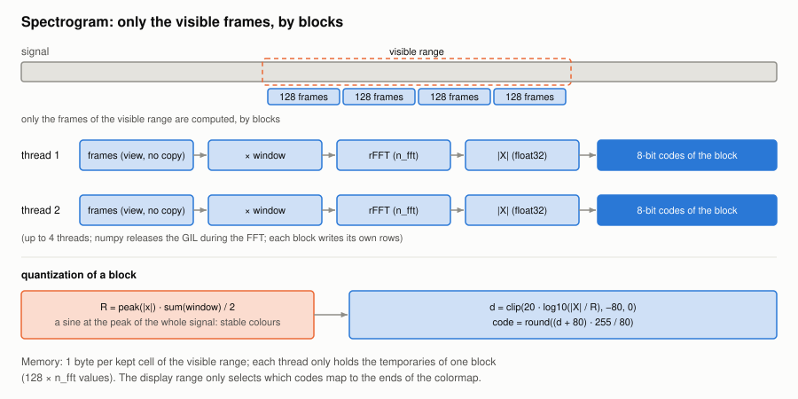

#+TITLE: Spectrogram: computing only the visible part
#+OPTIONS: toc:nil num:t

Implementation: [[file:../../spiny/plugins/spectrum/extractor.py]] and [[file:../../spiny/plugins/spectrum/control.py]].

* The problem

The spectrogram was computed with librosa in one go and kept in float64:

#+begin_example
X  = librosa.stft(signal, n_fft, hop, win_length, window, center=True)   # complex, all frames × all bins
S  = |X| / max |X|
dB = librosa.amplitude_to_db(S)                                            # several float copies
dB = dB.T[:, first_bin:last_bin], clipped to [L, H]
#+end_example

With the old default settings (FFT of 2 × 2048 points, 5 ms hop) a 10-minute recording at 16 kHz had
120 001 frames of 2 049 bins: the complex STFT alone is about 2 GB, followed by several float32 copies
of about 1 GB each (magnitude, normalization, power, decibels). The process went over 4 GB and was
killed. Most of that memory held bins that were cropped away at the end (above 5 kHz), or values that
are finally displayed with a colormap of a few hundred colours.

* The algorithm

A screen shows at most a few thousand frames, so only the frames of the visible part of the signal are
computed, by blocks, and stored as 8-bit codes. The framing and the window are the ones of librosa.

** Framing (as librosa's =stft(center=True)=)

With a hop of h samples and an FFT length n_fft, the signal is padded with n_fft / 2 zeros on each side
and frame t is centred on sample t × h; there are 1 + ⌊N / h⌋ frames. The frames of a block
[t0, t1) only need the samples

#+begin_example
[t0 × h − n_fft/2,  (t1 − 1) × h − n_fft/2 + n_fft)
#+end_example

which are copied into a zero-padded segment (the padding is only materialized at the two ends of the
signal). The frames are a strided view of that segment (=np.lib.stride_tricks.sliding_window_view=,
no copy), multiplied by the window and transformed by a real FFT along each row.

** FFT length

The FFT length is chosen automatically: the frames are zero-padded to at least 2048 samples and twice the window (more for
very long windows). Zero-padding adds no information but gives a smooth frequency axis, even for a
short (wideband) window. Only the bins up to the maximum frequency of the analysis are kept.

** Windows

The window of w samples (the frame length) is *periodic*, as =scipy.signal.get_window= and librosa
build it: the symmetric window of w + 1 samples without its last sample. It is zero-padded, centred,
to n_fft samples. hamming, hann, blackman, blackmanharris, bartlett and boxcar are implemented with
numpy.

** Only the visible frames

The visible time range [start, end] is converted into frames, and only these are computed:

#+begin_example
first frame = floor(start / frame_duration)
end frame   = ceil(end / frame_duration) + 1        (both clipped to the frames of the signal)
frame_duration = hop / sampling rate
#+end_example

The spectrogram remembers the time of its first frame, which places it on the time axis.

** Decibels and quantization

The levels are relative to a reference R which does not depend on the part being analysed, so that the
colours do not change when the view moves:

#+begin_example
R    = peak(|x|) × sum(window) / 2                   # the magnitude of a sine at the peak of the whole signal
d    = clip(20 × log10(max(|X| / R, 1e-5)), −80, 0)  # dB
code = round((d + 80) × 255 / 80)                    # 0 ... 255, stored as uint8
#+end_example

This requires one scan of the samples (no FFT). Normalizing by the maximum of the spectrogram would need
the whole STFT; normalizing by the maximum of the visible part would make the colours jump while
panning. A quiet recording still fills the scale, since R follows its peak; a magnitude above R (a
constant signal, for example) is clipped to 0 dB.

One code is 0.31 dB, finer than any colormap can show. The displayed range (say −70 to 0 dB) is not part
of the analysis: it only chooses which codes are mapped to the ends of the colormap.

** Parallel blocks

The frames are processed by blocks of 128, each block being transformed and quantized at once. numpy's FFT
releases the GIL, so the blocks are computed by a pool of up to 4 threads
(=concurrent.futures.ThreadPoolExecutor=). Each block writes its own rows of the result: there is
nothing to lock.

** Memory

For F visible frames and K kept bins:

| Data                               | Size                 | When                      |
|------------------------------------+----------------------+---------------------------|
| uint8 result                       | F × K bytes          | kept                      |
| per thread: frames, FFT, magnitude | ≈ 128 × n_fft × 12 B | during one block (≈ 6 MB) |

With the default settings (5 ms, K = 641), a view of 30 s and its margins (see below) give F = 12 001:
about 7 MB, whatever the length of the recording.

* Live update of the spectrogram

The spectrogram panel has no "Extract" button: the spectrogram follows the view and the sliders.

** Display settings: instant

The frequency range, the maximum level and the dynamic range do not need a new analysis:

- the levels [max − range, max] dB are converted to codes and given to the image item as its levels
  (=DataWidget.setLevels=): only the colormap mapping changes;
- the frequency range is the visible part of the y axis (=DataWidget.setYView=).

Only a maximum frequency above the analysed ones starts a new analysis (to compute the missing bins).

** View and analysis settings: in the background

A change of the visible range, of the window, of the window length or of the time step needs a new
analysis. To keep the interface responsive:

1. *Throttle*: a change starts a 30 ms timer, unless it is already running, so a burst of mouse events starts one
   analysis, and the view keeps being updated during a drag. (Restarting the timer at each event, as a debounce does,
   would compute nothing until the user stops moving.)
2. *Margin*: an analysis also covers half of the width of the view on each side (30 s at most), so a drag first
   reveals what is already computed. The next analysis starts when half of this margin has been used.
3. *Reuse*: with the same settings, the frames of the current spectrogram are copied, and only the new ones are computed.
4. *Nothing to do?* If the current spectrogram has the same settings and already contains the
   visible range (after a zoom-in, for example), nothing is computed.
5. *Background thread*: the analysis (=compute_spectrogram=, which only reads its arguments) runs in
   a single worker thread; the current spectrogram stays visible meanwhile, with an "Updating…"
   message under the panel.
6. *Back to the GUI thread*: when the analysis ends, the worker emits a Qt signal of an object living
   in the GUI thread; Qt queues it, so the result is always stored and drawn by the GUI thread.
7. *Only the latest result*: each analysis has a generation number. A result whose generation is not
   the latest one is dropped (the view became too long, a new signal was loaded, or another plugin was
   selected). A request made while an analysis is running waits for it, and only the latest request
   is kept.

** Maximum visible duration

The "Max visible duration" slider (30 s by default, up to 600 s) bounds the work and the memory:

#+begin_example
visible duration > maximum:   free the spectrogram, show a message over the plot, compute nothing
visible duration ≤ maximum:   remove the message, compute and show the visible part
#+end_example

The same rule applies when the plugin is selected, when the view changes and when the slider moves. The
message does not intercept the mouse, so the user can zoom in directly over it.

* Replicating Praat

With the method "Praat", the plugin computes what =Sound: To Spectrogram...= computes:

#+begin_example
physical width = 2 × effective width       the Gaussian window, zero at the edges: (exp(−48 φ²) − e⁻¹²) / (1 − e⁻¹²)
time step      = max(time step, effective width / √π / 8)
frames         = ⌊(duration − physical width) / time step⌋ + 1, centred in the signal
FFT length     = power of 2, at least the window and 2 × bins × nyquist / maximum frequency
bin            = ⌊frequency step × FFT length / rate⌋ FFT bins, whose powers are added
power          = |FFT(frame × window)|² / (Σ window² × FFT bins per bin)
#+end_example

The frames are not always evenly spaced in samples (a 3.3 ms step, for instance), so each one is read from its own
start. As for the standard method, only the frames around the view are computed. The levels are relative to the maximum
of the whole analysis, as in the plugin "Spectrogram (Praat)": this maximum needs the analysis of the whole signal,
once per file and settings (kept for the following analyses).

Against parselmouth, on the same settings, the shape, the times and the frequency step are the same, and the values are
the same within one 8-bit code (0.31 dB), the rounding of the two conversions. When the time step is not a whole
number of samples, a frame falling exactly between two samples can start one sample away from Praat's (23 µs at 44.1 kHz).

* Validation

The tests check that:

- the codes match librosa's =stft= + =amplitude_to_db= with the same reference, within one code;
- the visible part has exactly the codes of the same frames in the analysis of the whole signal;
- analysing a quiet part alone does not raise its level (the reference stays the one of the whole signal);
- panning computes the new part, zooming in a computed part computes nothing, and a too long view shows
  the message until the view is short enough (including exactly the maximum).

* Results

On the 10-minute recording, with the maximum of 30 s:

| Measure                                      | Before                       | After                   |
|----------------------------------------------+------------------------------+-------------------------|
| Open the recording (full view)               | killed (> 4 GB)              | message, nothing computed |
| Show a 30 s view                             | whole spectrogram required   | 47 ms                   |
| Pan a 30 s view by a page: shown after       | not applicable               | 94 ms                   |
| Pan a 30 s view by 2 %                       | not applicable               | already computed        |
| Longest interface freeze during a fast drag  | not applicable               | 57 ms                   |
| Peak memory of the session                   | killed (> 4 GB)              | 313 MB                  |

On the 2-minute recording, the old code took 5.53 s and 1 324 MB to open the spectrogram of the whole
recording. With the debounce and an FFT of 4096 points, the page took 261 ms to show, and nothing was updated during a
drag: the margin, the reuse and the throttle fixed this. librosa is no longer used by spiny, which also saves its import (about 1 s and 100 MB).
