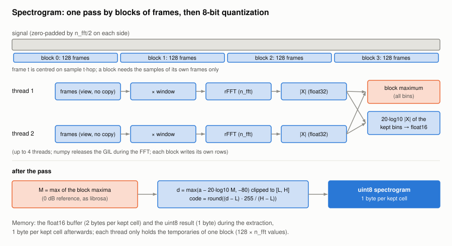

#+TITLE: Spectrogram: block-wise STFT and 8-bit quantization
#+OPTIONS: toc:nil num:t

Implementation: [[file:../../spiny/plugins/spectrum/extractor.py]] (commits =5481f81= and =f3f9bc0=).

* The problem

The spectrogram was computed with librosa in one go and kept in float64:

#+begin_example
X  = librosa.stft(signal, n_fft, hop, win_length, window, center=True)   # complex, all frames × all bins
S  = |X| / max |X|
dB = librosa.amplitude_to_db(S)                                            # several float copies
dB = dB.T[:, first_bin:last_bin], clipped to [L, H]
#+end_example

With the default settings (FFT of 2 × 2048 points, 5 ms hop) a 10-minute recording at 16 kHz has
120 001 frames of 2 049 bins: the complex STFT alone is about 2 GB, followed by several float32 copies
of about 1 GB each (magnitude, normalization, power, decibels). The process went over 4 GB and was
killed. Most of that memory held bins that were cropped away at the end (above 5 kHz), or values that
are finally displayed with a colormap of a few hundred colours.

* The algorithm

The result is the same as before (same framing, same window, same decibel scale), but it is computed
by blocks of frames and stored as 8-bit codes.

** Framing (as librosa's =stft(center=True)=)

With a hop of h samples and an FFT length n_fft, the signal is padded with n_fft / 2 zeros on each side
and frame t is centred on sample t × h; there are 1 + ⌊N / h⌋ frames. The frames of a block
[t0, t1) only need the samples

#+begin_example
[t0 × h − n_fft/2,  (t1 − 1) × h − n_fft/2 + n_fft)
#+end_example

which are copied into a zero-padded segment (the padding is only materialized at the two ends of the
signal). The frames are a strided view of that segment (=np.lib.stride_tricks.sliding_window_view=,
no copy), multiplied by the window and transformed by a real FFT along each row.

** Windows

The window of w samples (the frame length) is *periodic*, as =scipy.signal.get_window= and librosa
build it: the symmetric window of w + 1 samples without its last sample. It is zero-padded, centred,
to n_fft samples. hamming, hann, blackman, blackmanharris, bartlett and boxcar are implemented with
numpy.

** Decibels and quantization

librosa normalizes by the global maximum M of the magnitude (over all frames and all bins) and
floors the result 80 dB below it. The displayed value of a cell is then clipped to the chosen range
[L, H] (−70 dB to 0 dB by default) and quantized on 8 bits:

#+begin_example
d    = max(20 × log10(max(|X| / M, 1e-5)), −80)     # dB relative to the maximum
d    = clip(d, L, H)
code = round((d − L) × 255 / (H − L))                # 0 ... 255, stored as uint8
#+end_example

The 256 codes cover the displayed range: 0.27 dB per code for 70 dB, finer than any colormap can
show. The image is displayed with the fixed levels (0, 255), so the colormap maps code 0 to L dB and
code 255 to H dB.

** One pass with a float16 buffer

The quantization needs M, which is only known once every frame has been transformed. Instead of
computing the STFT twice, the extraction makes a single pass and stores, for the kept bins
[first_bin, last_bin) only, the *absolute* decibels in float16:

#+begin_example
for each block of 128 frames:
    X = rfft(frames × window)
    a[block, kept bins] = 20 × log10 |X[kept bins]|     # float16 (−inf for a null magnitude)
    block maximum = max |X|                              # over all the bins
M = max of the block maxima
codes = quantize(a − 20 × log10 M)                       # block by block, into the uint8 result
#+end_example

float16 has an 11-bit significand: for absolute levels up to 128 dB, the rounding error is at most
0.03 dB (0.0625 dB steps), well below the 0.27 dB of a code. A null magnitude gives −inf dB, which ends up at code 0, as before.

** Parallel blocks

numpy's FFT releases the GIL, so the blocks are computed by a pool of up to 4 threads
(=concurrent.futures.ThreadPoolExecutor=). Each block writes its own rows of the float16 buffer and
returns its maximum: there is nothing to lock. The global maximum is the maximum of the returned
values.

** Memory

For F frames and K kept bins:

| Data                              | Size                  | When                         |
|-----------------------------------+-----------------------+------------------------------|
| float16 buffer                    | 2 × F × K bytes       | during the extraction        |
| uint8 result                      | F × K bytes           | kept                         |
| per thread: frames, FFT, magnitude | ≈ 128 × n_fft × 12 B | during one block (≈ 6 MB)    |

For 10 minutes with the default settings (F = 120 001, K = 1 280): about 460 MB during the
extraction, 154 MB afterwards, instead of more than 4 GB.

* Validation

A test computes the spectrogram of the example recording both ways (librosa's =stft= +
=amplitude_to_db= on one side, this implementation on the other) and checks that the 8-bit codes
differ by at most one (rounding).

* Results

| Measure                                       | Before          | After  |
|-----------------------------------------------+-----------------+--------|
| Open the spectrogram, 2 min (time)            | 2.71 s          | 0.62 s |
| Open the spectrogram, 2 min (memory, peak)    | 1 323 MB        | 329 MB |
| Open the spectrogram, 10 min                  | killed (> 4 GB) | 3.02 s |

librosa is no longer used by spiny, which also saves its import (about 1 s and 100 MB, mostly numba).
