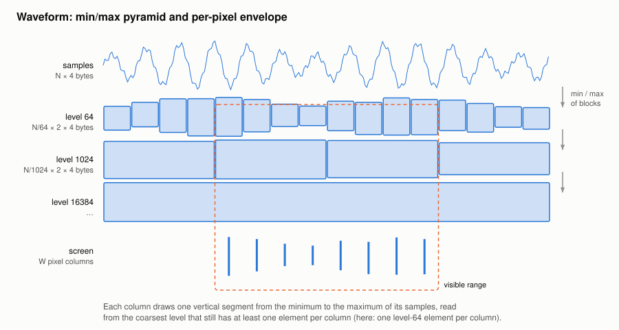

#+TITLE: Waveform rendering: min/max pyramid
#+OPTIONS: toc:nil num:t

Implementation: =WaveformItem= in [[file:../../spiny/core/wav/visualisation.py]] (commit =2039dda=).

* The problem

The waveform was drawn by a pyqtgraph =PlotDataItem= holding one point per sample:

- a float64 time value per sample (=np.arange(N) / sr=): 8 bytes per sample;
- a =QPainterPath= with one element per sample, rebuilt by pyqtgraph from the arrays: about 24 bytes
  per sample;
- every repaint walked through the whole path, even when a few seconds were visible.

For a 10-minute recording at 16 kHz (N = 9.6 million samples), the first paint added about 420 MB and
took 1.7 s. Yet a screen of W = 1500 pixels can show at most W distinct columns: the information
actually drawn is O(W), not O(N).

* The algorithm

** Pre-computation: a min/max pyramid

When a signal is loaded, the item builds a few levels, each summarizing blocks of samples by their
minimum and their maximum:

| Level | Block size (samples) | Elements | Memory (float32 min + max) |
|-------+----------------------+----------+----------------------------|
| 1     | 64                   | N / 64   | N / 8 bytes                |
| 2     | 1 024                | N / 1024 | N / 128 bytes              |
| 3     | 16 384               | N / 16384| N / 2048 bytes             |

Each level is computed from the previous one (the minimum of minimums is the minimum, and the same for
the maximums), with one vectorized =reshape(-1, 16).min(axis=1)= per level:

#+begin_src python
mins = maxs = signal
previous_factor = 1
for factor in (64, 1024, 16384):
    step = factor // previous_factor
    nb_blocks = mins.shape[0] // step
    mins = mins[: nb_blocks * step].reshape(nb_blocks, step).min(axis=1)
    maxs = maxs[: nb_blocks * step].reshape(nb_blocks, step).max(axis=1)
    levels.append((factor, mins, maxs))
    previous_factor = factor
#+end_src

The whole pyramid costs about N / 8 + N / 128 + ... ≈ 0.13 N bytes, i.e. about 3% of the signal
itself (4 N bytes in float32), and is built in one pass over the samples. The signal is referenced,
never copied.

** Painting: one segment per pixel column

At each repaint, the item reads the visible time range [x_min, x_max] and the width W of the view in
pixels, and converts the range into samples [first, last). With V = last − first visible samples:

1. *Zoomed in* (V / W ≤ 2 samples per pixel): the visible samples are drawn as a polyline, at most
   2 W points.
2. *Zoomed out*: the item picks the *coarsest level whose block size f is still ≤ V / W*, so that every
   pixel column contains at least one element of that level. Since the block sizes grow by a factor
   16, the visible range contains between W and 16 W elements of the chosen level (or of the raw
   samples when V / W < 64).
3. The elements of the visible range are split in W groups, one per column. The first element of
   column c is

   #+begin_example
   boundary(c) = floor(start + c × (V / W) / f)        (start = first / f)
   #+end_example

   and the minimum and maximum of each group are computed in one call each with
   =np.minimum.reduceat= / =np.maximum.reduceat=.
4. One vertical segment per column, from its minimum to its maximum, is drawn with a single
   =QPainterPath= built by =pg.arrayToQPath(x, y, connect="pairs")=.

The pyramid levels only cover whole blocks: the last (incomplete) block of the signal, fewer than f
samples, is read from the samples themselves and merged into the last column.

** Properties

- *Exact at the pixel level*: a column covers whole blocks of the chosen level, so its boundaries
  may move by less than f samples, i.e. by less than one pixel (f ≤ V / W). The minimum and the
  maximum of each column are exact for the samples it covers: no peak is lost, unlike decimation.
- *Cost*: O(N) once at load time; O(W) per repaint (at most 16 W elements read), whatever the
  length of the recording or the zoom level.
- *Memory*: about 3% of the signal instead of about 8 times the signal (time array and path).

* Results

| Measure                                    | Before | After  |
|--------------------------------------------+--------+--------|
| Memory added by the first paint, 10 min    | 422 MB | 25 MB  |
| First paint, 10 min                        | 1.67 s | 0.10 s |
| Pan in a 5 s view, 10 frames, 2 min        | 0.41 s | 0.09 s |

(The first paint and pan times include the rendering of the whole window, not only the waveform.)
