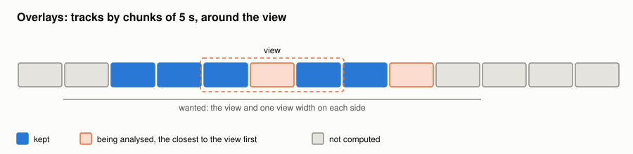

#+TITLE: Overlays
#+OPTIONS: toc:nil num:t

Implementation: [[file:../../spiny/core/overlay.py]].

An overlay draws over the plot of a visualisation plugin. A visualisation plugin declares what it supports
(=DataController.overlays=), which needs a y axis in Hz; both spectrograms support all the overlays. Overlays are only drawn
and computed when the visualisation shows something (=DataWidget.isPlotting=): they disappear with a spectrogram hidden
because the view is too long.

* Tracks by chunks

Formants and F0 are tracks: values at regular times. A track takes very little memory, so nothing has to be freed.

1. The tracks are computed by chunks of 5 s, on a fixed grid: frame t is centred on the time t × time step.
2. The chunks missing around the view are computed by two shared background threads, those closest to the view first, also
   one view width on each side, at most two at a time per overlay.
3. The chunks are kept: coming back to a part of the signal needs no new analysis, and a long view fills in progressively.
4. A change of the settings forgets the chunks; a generation number drops the results being computed. The old curves stay
   until the new ones arrive.
5. Only the part of the tracks around the view is given to the plot, at most 4000 points, with half a view more on each
   side, so that small pans do not need any drawing.

* Drawing

A line is cut at gaps, and where a value changes by more than 25 % between two points: a line across a jump is a vertical
stroke which looks like data.
