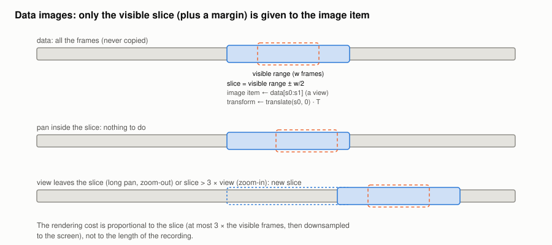

#+TITLE: Data images
#+OPTIONS: toc:nil num:t

Implementation: =DataWidget= and =SmoothedImageItem= in [[file:../../spiny/gui/widgets.py]], colormaps in
[[file:../../spiny/gui/colormaps.py]]. Every visualisation plugin draws through this widget.

* The visible slice

A pyqtgraph =ImageItem= converts its whole image at every render, and when zoomed in it renders every frame. So the widget
keeps the data and only gives the image item a slice, which is a numpy view (nothing is copied, even for a memory map):

1. the visible range is mapped to frames with the inverse of the data transform: [f0, f1), of width w;
2. the slice covers these frames and a margin of w / 2 on each side: [s0, s1), clipped to the data;
3. the item transform is the data transform preceded by a translation of s0 frames.

The slice is kept while it covers the view and is not too large:

#+begin_example
keep [s0, s1)  if  s0 ≤ f0  and  f1 ≤ s1  and  s1 − s0 ≤ 3 × w
otherwise      new slice = [f0 − w/2, f1 + w/2)
#+end_example

A small pan needs nothing, and a zoom-in does not keep rendering a slice much larger than the view. A plugin which is not
displayed anymore frees its data; it is extracted again when it is selected again.

* Levels

When a plugin gives no levels (raw coefficients), they are estimated once from at most one million values, so that they
do not change while panning. The spectrograms give them explicitly: the display range only selects which 8-bit codes map
to the ends of the colormap.

* Colormaps

The perceptually uniform colormaps come from pyqtgraph. The others are piecewise linear: each channel is a list of
(position, value) breakpoints, evaluated at the union of the breakpoints of the three channels, so that the linear
interpolation between stops is exact. Inverting a colormap reverses a copy, as pyqtgraph caches the original one.

The gradient editor of pyqtgraph would import matplotlib and colorcet only to fill a menu: =blocked_imports= makes them
unimportable while the editor is created.

* Smoothing

Smoothing applies after the rendering, on what the plugin has produced, so it works for every plugin:

| Strategy | Operation                                                         |
|----------+-------------------------------------------------------------------|
| None     |                                                                   |
| Bilinear | the painter interpolates when it scales the image: no extra image |
| Box      | filter (1, 1, 1) along each axis                                  |
| Gaussian | filter (1, 4, 6, 4, 1) along each axis                            |

The filters run on the colours, after the lookup table: an image with a lookup table contains indices, which cannot be
averaged. They work in image pixels, with extended edges, each time the image is rendered.
