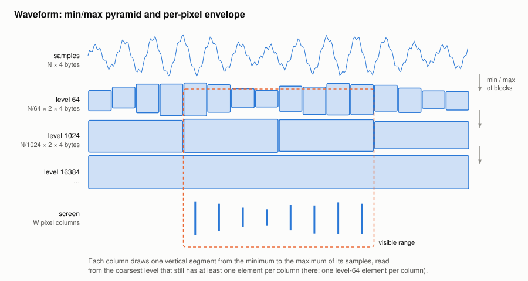

#+TITLE: Waveform
#+OPTIONS: toc:nil num:t

Implementation: =WaveformItem= in [[file:../../spiny/core/wav/visualisation.py]].

A screen of W pixels shows at most W distinct columns, whatever the length of the recording: drawing should cost O(W),
not O(number of samples).

* A min/max pyramid

When a signal is loaded, the item builds levels which summarize blocks of samples by their minimum and their maximum:

| Level | Block size (samples) | Elements  |
|-------+----------------------+-----------|
| 1     | 64                   | N / 64    |
| 2     | 1 024                | N / 1024  |
| 3     | 16 384               | N / 16384 |

Each level is computed from the previous one, as the minimum of minimums is the minimum. The pyramid costs about 3 % of
the memory of the signal, which is referenced and never copied.

* One segment per pixel column

With V visible samples and a view of W pixels:

1. *Zoomed in* (V / W ≤ 2): the visible samples are drawn as a polyline.
2. *Zoomed out*: the coarsest level whose block size f is ≤ V / W is used, so that every column has at least one element.
3. The elements of the view are split in W groups, the first element of column c being
   #+begin_example
   boundary(c) = floor(start + c × (V / W) / f)        (start = first / f)
   #+end_example
   and =np.minimum.reduceat= and =np.maximum.reduceat= give the minimum and the maximum of each group.
4. One vertical segment per column is drawn with one path, at the centre of its column.

The levels only cover whole blocks: the last, incomplete one is read from the samples. No peak is lost, unlike with a
decimation, and a repaint costs O(W) whatever the zoom.

* Keeping the path

The path only depends on the view: (first sample, last sample, number of columns). It is kept between two repaints, so
that a moving playhead, which repaints the plot, does not rebuild it.

* The playhead

=PlayheadLine=, on every plot, reads the position of the player every 30 ms. It only moves when its plot is visible and
the position moved by at least half a pixel: on a full view of a long recording, the position takes many polls to cross
one pixel, and each move repaints the plot under the line.
