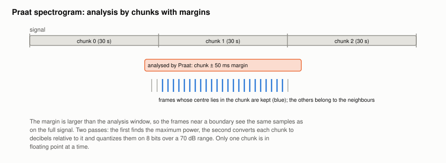

#+TITLE: Spectrogram (Praat) plugin
#+OPTIONS: toc:nil num:t

Implementation: [[file:../../spiny/plugins/spectrum_praat/extractor.py]].

This plugin calls Praat itself through parselmouth, with its default parameters. It is kept as a reference to debug the
[[file:spectrogram.org][Spectrogram plugin]]. parselmouth is optional: the plugin only checks at startup that it is installed, and imports it when
the spectrogram is first computed.

* Chunks with margins

The whole signal is analysed, by chunks of 30 s. For the chunk [s, e):

1. Praat analyses [s − m, e + m), with a margin m = 50 ms, larger than the window, so that the frames near the boundaries
   see the same samples as on the full signal;
2. the frame times are shifted by the start of the analysed span;
3. only the frames centred in [s, e) are kept.

* Two passes and 8 bits

Only one chunk is held in floating point at a time:

#+begin_example
pass 1:  P_max = maximum power over all chunks
pass 2:  d    = clip(10 × log10(P / P_max), −70, 0)
         code = round((d + 70) × 255 / 70)
#+end_example

The frames of the chunks are placed as if they were evenly spaced from 0, so they are drawn slightly earlier than their
real times, by less than the first frame time of Praat.
