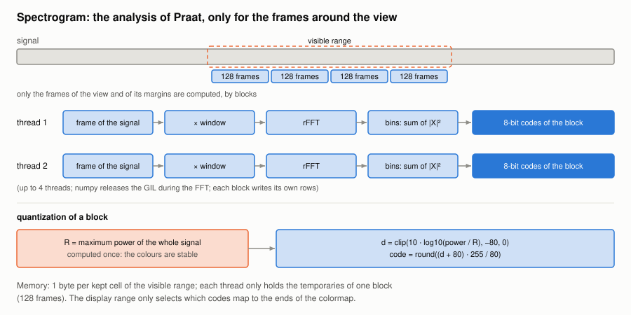

#+TITLE: Spectrogram plugin
#+OPTIONS: toc:nil num:t

Implementation: [[file:../../spiny/plugins/spectrum/extractor.py]] and [[file:../../spiny/plugins/spectrum/control.py]].

The plugin computes what =Sound: To Spectrogram...= of Praat computes, in numpy, and only for the frames around the view.

* Parameters

| Parameter         | Default  |
|-------------------+----------|
| Window length     | 5 ms     |
| Maximum frequency | 5000 Hz  |
| Time step         | 2 ms     |
| Frequency step    | 20 Hz    |
| Window shape      | Gaussian |

* The analysis

With a sampling period dt:

#+begin_example
physical width = effective width (twice it for the Gaussian window)
window samples = 2 × (⌊physical width / dt⌋ // 2 − 1)
time step      = max(time step, effective width / √π / 8)
frequency step = max(frequency step, √π / effective width / 8)
frames         = ⌊(duration − physical width) / time step⌋ + 1, centred in the signal
FFT length     = power of 2, at least the window and 2 × bins × Nyquist / maximum frequency
FFT bins per bin = max(1, ⌊frequency step × dt × FFT length⌋)
power          = sum over the FFT bins of the bin |FFT(frame × window)|² / (Σ window² × FFT bins per bin)
#+end_example

The window, with φ = i / (physical width / dt) for i = 1 ... samples:

| Shape    | Value                                                   |
|----------+---------------------------------------------------------|
| Gaussian | (exp(−48 x²) − e⁻¹²) / (1 − e⁻¹²), x centred on the window |
| Hanning  | 0.5 − 0.5 cos(2π φ)                                     |
| Hamming  | 0.54 − 0.46 cos(2π φ)                                   |
| Bartlett | 1 − abs(2φ − 1)                                         |
| Welch    | 1 − (2φ − 1)²                                           |
| Square   | 1                                                       |

A time step which is not a whole number of samples gives frames which are not evenly spaced, so each frame is read from
its own start.

Compared with Praat through parselmouth, the shape, the times and the values match, within one 8-bit code. When a frame
falls exactly between two samples, it can start one sample away from Praat's.

* Levels on 8 bits

The levels are relative to the maximum R of the analysis of the whole signal, so that the colours do not change when the
view moves:

#+begin_example
d    = clip(10 × log10(max(power / R, 1e-10)), −80, 0)
code = round((d + 80) × 255 / 80)
#+end_example

Finding R needs the analysis of the whole signal, without storing it, once per file and per settings. One code is
0.31 dB, finer than any colormap can show.

* Only the frames around the view

Frames are computed by blocks of 128, by up to 4 threads (numpy's FFT releases the interpreter); each block writes its own
rows. The memory is one byte per kept cell, whatever the length of the recording.

* Following the view

1. *Display settings* (minimum frequency, maximum level, dynamic range) change the levels or the y view: no analysis.
2. *A change of the view or of an analysis setting* starts a 30 ms timer, unless it is running: a burst of mouse events
   starts one analysis, and the view keeps being updated during a drag.
3. *A margin*: an analysis also covers half of the width of the view on each side (30 s at most), so a drag first reveals
   what is already computed. The next analysis starts when half of the margin has been used.
4. *Reuse*: with the same settings, the frames already computed are copied, and only the new ones are computed.
5. *In the background*: the analysis runs in a worker thread. Each one has a generation number, so that the result of an
   outdated one is dropped, and a request made during an analysis waits for it, only the latest being kept.
6. *Maximum visible duration*: above it (30 s by default), the spectrogram is freed and a message is shown instead.
